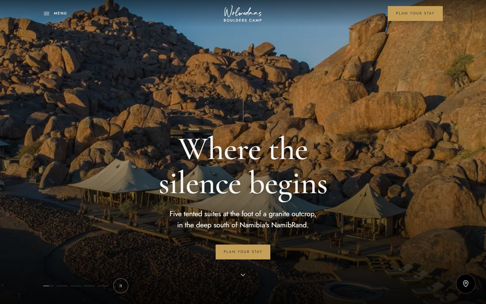

# Boulders Camp · Wolwedans

A website prototype for **Wolwedans Boulders Camp** in Namibia's NamibRand Nature Reserve, built for the Creo Media Stage 2 assessment (Part 1).

**Live site:** https://boulders-camp.vercel.app

---

## The brief, in one line

Help someone **discover** Boulders Camp, **fall in love** with it, and **enquire directly** instead of going through a travel agent.

## Creative concept: *Where the silence begins*

The website is the experience: quiet, confident and premium, so that Boulders feels like *the one place*. The page follows a day in the desert. It starts on light dune neutrals, warms into ochre for "A day here", drops into a black night sky for the Antares star safari, and ends on a black footer. Full-bleed photo bands keep you in the landscape between sections.

- **Restraint:** one serif (Cormorant Garamond) and one sans (Jost), a fixed type scale, hairline dividers, square corners, no shadows and no collages.
- **Selling comes before complexity:** "Plan your stay" is always one tap away, in the header, the hero and a sticky bar on mobile.



## Features

Less talk, more showing: every section is a large image and one or two lines, with slow scroll reveals.

| Feature | What it does |
|---|---|
| **Hero** | Five full-screen photos crossfade with a slow Ken Burns zoom behind a black gradient. Only the headline, one line and "Plan your stay", plus a quiet pause control. Only the first photo loads up front. |
| **Photo bands** | The intro, the "Five suites. Ten guests. One sky." invitation and Guest voices sit over fixed full-bleed photos that load as they near the screen. |
| **Suites** | A swipeable row of portrait cards on the homepage, then a `/suites` page where each suite has its own story: a three-photo gallery (opens the lightbox), one evocative line and details as small icons. |
| **Fall for the quiet** | A slowly drifting strip of twelve photos, each gently zooming. Pauses on hover or focus, with a pause/play button; reduced-motion users get a still, swipeable row. A click opens a fullscreen lightbox over a blurred, darkened page, with arrows, swipe, keyboard ← → , Esc and X. |
| **Plan your stay** (`/plan`) | A Singita-style flow on its own page: logo and X close, "Step 1–5" progress, one question per step, large tappable option cards and Back/Next fixed at the bottom. 1 Dates and flexibility → 2 Guests and suites (live estimate) → 3 Interests → 4 Travel (arriving from, transfer) → 5 Details and review → calm confirmation with WhatsApp and email hand-off. Each step is validated, answers are kept when going back, and `?suite=` / `?interest=` pre-select choices. **Every** "Plan your stay" button on the site opens it. |
| **Map widget** | A round map-pin button (bottom-right) opens a small card (a sheet on mobile) with a Google map on Boulders Safari Camp, "Get directions", "Open in Google Maps" and how to get here. Closes with X, Esc or a click outside. "Find us" in the menu and footer opens it too. |
| **Experience page** | `/experience`: *A Day & Night at Boulders*, hour by hour, built from the same components. |
| **Quality** | No horizontal scroll from 320px to 1920px (plus landscape) on every page; tap targets of 44px or more; alt text on every image; keyboard support and focus return for the menu, lightbox, map and flow; `prefers-reduced-motion` respected. |

Screenshots of the hero, gallery, lightbox, map widget, suite story and every booking step, at 1440px and 375px, are in [`docs/screenshots`](docs/screenshots).

## Design system

Everything is defined once in `app/globals.css` (`@theme`) and reused through shared components.

- **Palette (60 / 30 / 10):** sand `#FAF7F2` and sand-2 `#F2E6D0`, ochre `#D9B98F`, ink `#2E2A27`, umber `#542E18` for labels, gold `#C5A059` (Plan your stay only, always with ink text), and black for every dark area (hero gradient, photo bands, night sky, footer). Every text pairing is checked at **4.5:1 or better**.
- **Grounds:** each section sets one ground (`sand`, `sand-2`, `ochre`, `navy` or `ink`), and its labels, secondary text and hairlines adapt automatically.
- **Type scale:** labels 11px with 0.2em tracking; body 17px with line-height 1.7; H3 26px; H2 `clamp(32px, 4vw, 52px)`; H1 `clamp(44px, 7vw, 96px)`.
- **Components** (`components/ui`): `Section`/`Container`, `Eyebrow`, `SectionHeading`, `Button` (solid, outline or gold), `ArrowButton`, `FactRow`, `ImageFrame` (4/5, 3/2 or 16/9 only), `Split` and `Logo`.
- **Logo:** the supplied Wolwedans wordmark files (`public/brand`) are used as-is: dark on light grounds, light on ink. The favicon and touch icon use the "W" from the same file.

## Tech stack, and why

- **Next.js 16 (App Router) + TypeScript:** pages are pre-rendered as static HTML, so they load fast and are SEO-friendly. TypeScript catches content-shape mistakes early.
- **Tailwind CSS v4:** design tokens live in one `@theme` block, and styling stays next to the markup, which makes changes quick.
- **Vercel:** every push to `main` deploys automatically.
- **No UI or animation libraries:** the motion is plain CSS plus one small `IntersectionObserver`, which keeps JavaScript to a minimum on mobile.

## Folder structure and CMS readiness

```
app/
  layout.tsx          Fonts, metadata, header, footer, sticky mobile bar
  (site)/            Story pages sharing the header, footer, mobile bar and map widget
    page.tsx          Homepage: an ordered list of sections
    suites/page.tsx   A visual story per suite
    experience/page.tsx Experience page
  plan/page.tsx       The 5-step Plan your stay flow (its own minimal shell)
  globals.css         Design system: colours, grounds, type scale, spacing, motion
components/           Sections. They render content and hold no copy.
components/ui/        Shared building blocks (Section, Button, FactRow, ImageFrame, Logo…)
content/              All text, data and image paths, as JSON
  site.json           Camp name, SEO, nav, contact, footer
  home.json           Homepage sections
  suites.json         The five suites
  day.json            The day timeline (shared by both pages)
  planner.json        Rates, rules and every step and option of the /plan flow
  suites-page.json    /suites page copy and the shared suite features
  experience.json     Experience page
lib/content.ts        Single entry point that loads and types the content
public/images/        WebP photos (originals in /original, partner logos in /logos)
public/brand/         Wolwedans logo files (dark and light)
docs/screenshots/     Homepage screenshots at 375px and 1280px
public/docs/          Official rate and activity PDFs
```

**Why it's CMS-ready:** components never contain copy. They import from `lib/content.ts`, which today reads local JSON. A headless CMS (Sanity, Contentful, Storyblok and so on) can replace those imports with API calls that return the same shapes, without changing any component. Each JSON file maps directly to a CMS content type: Site settings, Home page, Suite, Day moment, Planner settings and Experience page.

## Reusing the design for other Wolwedans camps

The design is a template. To launch Dune Camp or Plains Camp:

1. Copy `/content` and replace the text, suites, rates and image paths.
2. If needed, change the colour tokens in `app/globals.css`, the two fonts in `app/layout.tsx` and the logo files in `public/brand`.
3. No component changes are required. Sections that a camp doesn't need can be removed from `app/page.tsx`.

## Run it locally

Requires Node.js 20.9 or later.

```bash
git clone https://github.com/Kirubel007/boulders-camp.git
cd boulders-camp
npm install
npm run dev        # http://localhost:3000
npm run build      # production build
```

## Image credits

All photography, partner logos and rate documents are **© Wolwedans**, sourced from [wolwedans.com/boulders-camp-2](https://www.wolwedans.com/boulders-camp-2/) and used for this assessment prototype only.

## Data and privacy note

This is a design prototype. **It does not collect, send or store any guest data**, and it is not connected to any booking system. The planner and the journey-guide form only show on-screen confirmations. Guest quotes are marked as placeholders.
