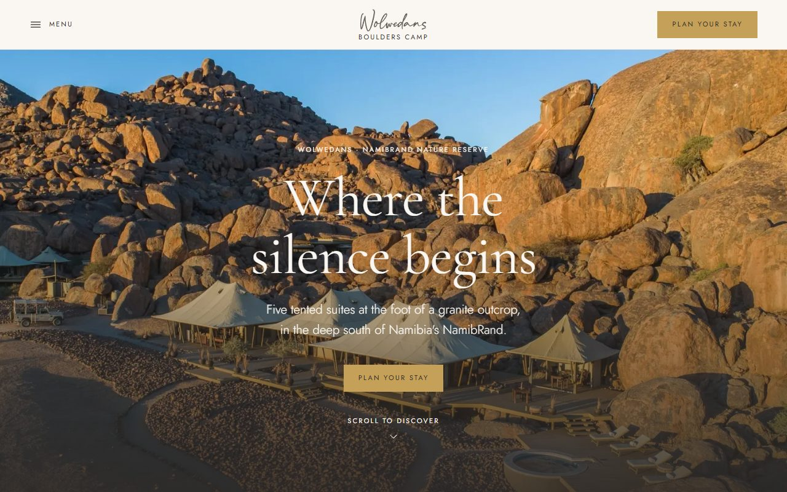

# Boulders Camp · Wolwedans

A website prototype for **Wolwedans Boulders Camp** in Namibia's NamibRand Nature Reserve, built for the Creo Media Stage 2 assessment (Part 1).

**Live site:** https://boulders-camp.vercel.app

---

## The brief, in one line

Help someone **discover** Boulders Camp, **fall in love** with it, and **enquire directly** instead of going through a travel agent.

## Creative concept: *Where the silence begins*

The website is the experience: quiet, confident and premium, so that Boulders feels like *the one place*. The page follows a day in the desert. It starts on light dune neutrals, warms into ochre for "A day here", drops into a single navy night sky for the Antares star safari, and ends on an espresso footer.

- **Restraint:** one serif (Cormorant Garamond) and one sans (Jost), a fixed type scale, hairline dividers, square corners, no shadows and no collages.
- **Selling comes before complexity:** "Plan your stay" is always one tap away, in the header, the hero and a sticky bar on mobile.



## Features

| Feature | What it does |
|---|---|
| **Hero** | A full-bleed still photo sized with `svh` (so the iOS address bar never cuts it), with an eyebrow, a headline, one line and one gold call to action. |
| **Header and menu** | The real Wolwedans logo, MENU and a gold "Plan your stay". The full-screen menu locks scrolling, keeps keyboard focus inside, closes on Escape or on any link tap, and returns focus to MENU. |
| **Suites** | Listing rows with a 3/2 image beside an ochre card: label, title, facts (Sleeps · Plunge pool), one line and an arrow button that **pre-selects the suite in the planner** and scrolls there. |
| **A day here** | A vertical timeline beside one sticky image on desktop, and swipeable cards on mobile. |
| **Night sky** | The one dark section: a real Milky Way photo with sand text over a navy gradient. |
| **Plan your stay** (interactive) | Dates (minimum 2 nights), adults and children (maximum 10, children 7+), suites (2 guests each, validated), included and on-request activities, and a **live estimate** (NAD 20,950 per person per night, levy excluded). Sends on WhatsApp, or opens a pre-filled email after a success summary. |
| **Find us** (interactive map) | A click-to-load Google map pinned on Boulders Safari Camp (-25.3304, 15.9767). Nothing loads from Google, and no cookies are set, until the visitor asks. Includes "Open in Google Maps" and "Directions". |
| **Lead generation** | A sticky mobile bar (WhatsApp + Plan your stay), the scarcity cue "Only 5 suites · max 10 guests", partner logos, placeholder guest quotes, a journey-guide signup and the rate-sheet PDFs. |
| **Experience page** | `/experience`: *A Day & Night at Boulders*, built from the same components. |
| **Quality** | Lighthouse mobile on the live site scores 91–92 for Performance and 100 for Accessibility, Best Practices and SEO. There is no horizontal scroll from 320px to 1920px, every tap target is at least 44px, every image has alt text, focus is always visible, and `prefers-reduced-motion` is respected. |

## Design system

Everything is defined once in `app/globals.css` (`@theme`) and reused through shared components.

- **Palette (60 / 30 / 10):** sand `#FAF7F2` and sand-2 `#F2E6D0`, ochre `#D9B98F`, ink `#2E2A27`, umber `#542E18` for labels, gold `#C5A059` (Plan your stay only, always with ink text), and navy `#2C3E50` for the night. Every text pairing is checked at **4.5:1 or better**.
- **Grounds:** each section sets one ground (`sand`, `sand-2`, `ochre`, `navy` or `ink`), and its labels, secondary text and hairlines adapt automatically.
- **Type scale:** labels 11px with 0.2em tracking; body 17px with line-height 1.7; H3 26px; H2 `clamp(32px, 4vw, 52px)`; H1 `clamp(44px, 7vw, 96px)`.
- **Components** (`components/ui`): `Section`/`Container`, `Eyebrow`, `SectionHeading`, `Button` (solid, outline or gold), `ArrowButton`, `FactRow`, `ImageFrame` (4/5, 3/2 or 16/9 only), `Split` and `Logo`.
- **Logo:** the supplied Wolwedans wordmark files (`public/brand`) are used as-is: dark on light grounds, light on ink. The favicon and touch icon use the "W" from the same file.

## Tech stack, and why

- **Next.js 16 (App Router) + TypeScript:** pages are pre-rendered as static HTML, so they load fast and are SEO-friendly. TypeScript catches content-shape mistakes early.
- **Tailwind CSS v4:** design tokens live in one `@theme` block, and styling stays next to the markup, which makes changes quick.
- **Vercel:** every push to `main` deploys automatically.
- **No UI or animation libraries:** the motion is plain CSS plus one small `IntersectionObserver`, which keeps JavaScript to a minimum on mobile.

## Folder structure and CMS readiness

```
app/
  layout.tsx          Fonts, metadata, header, footer, sticky mobile bar
  page.tsx            Homepage: just an ordered list of sections
  experience/page.tsx Experience page
  globals.css         Design system: colours, grounds, type scale, spacing, motion
components/           Sections. They render content and hold no copy.
components/ui/        Shared building blocks (Section, Button, FactRow, ImageFrame, Logo…)
content/              All text, data and image paths, as JSON
  site.json           Camp name, SEO, nav, contact, footer
  home.json           Homepage sections
  suites.json         The five suites
  day.json            The day timeline (shared by both pages)
  planner.json        Rates and rules for the planner
  experience.json     Experience page
lib/content.ts        Single entry point that loads and types the content
public/images/        WebP photos (originals in /original, partner logos in /logos)
public/brand/         Wolwedans logo files (dark and light)
docs/screenshots/     Homepage screenshots at 375px and 1280px
public/docs/          Official rate and activity PDFs
```

**Why it's CMS-ready:** components never contain copy. They import from `lib/content.ts`, which today reads local JSON. A headless CMS (Sanity, Contentful, Storyblok and so on) can replace those imports with API calls that return the same shapes, without changing any component. Each JSON file maps directly to a CMS content type: Site settings, Home page, Suite, Day moment, Planner settings and Experience page.

## Reusing the design for other Wolwedans camps

The design is a template. To launch Dune Camp or Plains Camp:

1. Copy `/content` and replace the text, suites, rates and image paths.
2. If needed, change the colour tokens in `app/globals.css`, the two fonts in `app/layout.tsx` and the logo files in `public/brand`.
3. No component changes are required. Sections that a camp doesn't need can be removed from `app/page.tsx`.

## Run it locally

Requires Node.js 20.9 or later.

```bash
git clone https://github.com/Kirubel007/boulders-camp.git
cd boulders-camp
npm install
npm run dev        # http://localhost:3000
npm run build      # production build
```

## Image credits

All photography, partner logos and rate documents are **© Wolwedans**, sourced from [wolwedans.com/boulders-camp-2](https://www.wolwedans.com/boulders-camp-2/) and used for this assessment prototype only.

## Data and privacy note

This is a design prototype. **It does not collect, send or store any guest data**, and it is not connected to any booking system. The planner and the journey-guide form only show on-screen confirmations. Guest quotes are marked as placeholders.
